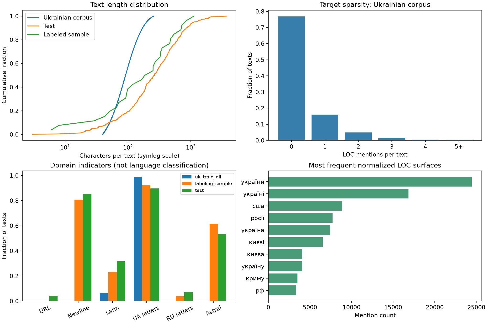

# Assignment 3 — EDA and Metric Analysis

Competition: [KSE UA Location Extraction 2026](https://www.kaggle.com/competitions/kse-ua-location-extraction-2026/overview). Analysis date: 8 November 2026.

## 1. Scope and reproducibility

This analysis covers **all 1,010,000 rows of the Ukrainian raw corpus**, the full corresponding processed Parquet, all 477 test texts, and all 26 labeled in-domain examples. The 2 GB Russian corpus is an auxiliary data source and is **not analyzed** here; no findings below describe its distribution. No test texts were manually labeled, no models were trained, and no CV or leaderboard scores are claimed.

The source pages are archived in `sources/`. File sizes and SHA-256 hashes, detailed counts, and metric checks are in `reports/eda_summary.json`. Run `python analyze.py`, then `python build_deliverables.py` from an environment with the listed dependencies. `eda_and_metrics.ipynb` contains executed result cells and a cell for reproducing the full analysis.

## 2. Data structure and quality

The task is to extract **location names and addresses** from Ukrainian, Russian, and mixed texts. Organization and person spans in the raw Ukrainian data are auxiliary annotations, not target classes for this competition. Training labels are half-open character spans: `text[start:end]`. The official submission contains `text_id` and a list of strings, not BIO tags or offsets.

| Dataset | Texts | Median characters | Median whitespace tokens | LOC mentions | Texts without LOC |
|---|---:|---:|---:|---:|---:|
| Ukrainian fit | 1,000,000 | 91.0 | 13.0 | 341,810 | 76.89% |
| Ukrainian validation | 10,000 | 92.0 | 13.0 | 3,304 | 76.97% |
| In-domain labeled sample | 26 | 217.5 | 31.5 | 32 | 38.46% |
| Unlabeled test | 477 | 264.0 | 36.0 | hidden | unknown |

Whitespace token counts are a descriptive length proxy, not BPE lengths or the provided tokenizer's output. In test, the 95th percentile is **1123.2 characters / 158.6 whitespace tokens**, and the maximum is **3,682 characters / 509 tokens**. The fraction exceeding 128 / 256 / 512 whitespace tokens is 8.60% / 1.89% / 0.00%. A sequence cap should therefore be measured against the chosen tokenizer; long test posts should be processed in overlapping windows with original offsets preserved.

Missing texts: train 0, sample 0, test 0. Empty/whitespace-only texts: train 0, sample 0, test 0. Test IDs contain 0 missing values and 0 duplicates. All test `locations` values are empty placeholders. **The true test entity prevalence is unknown**; treating these placeholders as negative labels would invalidate EDA and evaluation.

### Span audit

| Raw Ukrainian annotation check | Count |
|---|---:|
| out_of_bounds_or_empty | 0 |
| noninteger_offsets | 0 |
| duplicate_spans | 0 |
| overlapping_spans | 0 |
| whitespace_boundaries | 206 |
| empty_after_normalization | 311 |
| per_text_normalization_collapses | 3,051 |

There are 0 missing LOC annotation cells and 345,114 valid LOC spans. Out-of-range, empty or non-integer spans, if present, are excluded from surface extraction and recorded separately, rather than silently clipped. Overlap and whitespace checks flag cases for inspection; an overlap alone does not establish that an annotation is wrong. The 26 labeled examples have 0 invalid-span or string/span-set mismatch findings. This verifies bounds and consistency, not semantic correctness of every label.

### Prepared Parquet is not a span-preserving replacement

The Parquet contains `tokens, labels, is_valid` and 1,010,000 rows. Its tag vocabulary is `O/LOC`, **not BIO**. Token/label length mismatches: 0; rows with unexpected tags: 0. Raw/processed row counts agree: True; split columns agree positionally: True. These checks do not prove full token/text alignment.

The number of contiguous `LOC` token runs differs from the raw span count in **6,171 rows**. This is a preprocessing discrepancy, not proof of one single cause: adjacent entity merging, token boundaries, or lost annotations may contribute. IO tags cannot distinguish two adjacent LOC entities without a non-LOC separator. Use the raw spans to build BIO targets and keep token-to-character offsets. Decode strings by slicing the original text; joining token strings can change punctuation and spacing.

## 3. Target distribution and useful implications

The Ukrainian corpus contains 345,114 annotated LOC mentions; **76.89%** of texts have no LOC. LOC spans cover **2.93%** of all text characters, and 15.39% of mentions contain more than one whitespace token. Character coverage is not token prevalence. The processed file contains 17,384,464 `O` and 424,864 `LOC` labels: predicting `O` everywhere reaches **97.61% token accuracy** while finding no location entities. This is why overall token accuracy is a poor primary NER metric.

There are 45,430 distinct raw LOC surfaces and 43,540 after official normalization. The ten most frequent normalized surfaces account for 25.15% of mentions; 69.12% of distinct normalized surfaces occur only once. Report both common and unseen-name performance: a frequent-place dictionary may look good on micro-F1 while failing on rare names and inflected forms. Morphologically different surfaces are not necessarily different real places.

In the in-domain labeled sample, 16/26 texts contain a LOC, with 32 mentions; 10/26 contain none. Its 26 texts and 32 mentions are insufficient for stable model ranking or detailed language-specific estimates. In particular, the observed 38.46% empty fraction is not an estimate precise enough to impose on test predictions.



## 4. Train/test shift and leakage checks

| Indicator, fraction of texts | Ukrainian corpus | Labeled sample | Test |
|---|---:|---:|---:|
| url | 0.03% | 0.00% | 3.98% |
| newline | 0.00% | 80.77% | 85.12% |
| latin | 6.65% | 23.08% | 31.66% |
| ua_specific | 98.73% | 92.31% | 89.73% |
| ru_specific | 0.08% | 3.85% | 7.13% |
| astral_unicode | 0.00% | 61.54% | 53.25% |

UA-specific letters (`іїєґ`) and RU-specific letters (`ыэёъ`) are **heuristic presence indicators, not language labels**. A short Ukrainian sentence can contain none of these letters; a mixed post can contain both. Astral Unicode includes many emoji but is not equivalent to an emoji detector. Preserve Unicode offsets: Python code-point offsets differ from UTF-16 offsets after an astral character.

The two-sample KS statistics for raw corpus versus test are **0.5630** for character length and **0.5532** for whitespace-token length. These measure empirical distribution differences, not model quality or causation. The test set has only 477 texts, and the huge training set makes statistical significance less useful than effect sizes. Formatting and length differences motivate a domain-sensitive holdout and error analysis rather than an automatic claim that the supplied validation predicts leaderboard performance.

| Pair (first → second) | Shared exact unique texts | Exact-overlap rows in second | Canonical-overlap rows in second |
|---|---:|---:|---:|
| uk_train_all → test | 0 | 0 | 0 |
| uk_train_all → labeling_sample | 0 | 0 | 0 |
| labeling_sample → test | 0 | 0 | 0 |
| uk_fit → uk_valid | 52 | 52 | 52 |

The raw Ukrainian corpus has 2,454 exact duplicate excess rows and 2,523 after NFC normalization, case folding and whitespace collapse. Among repeated exact texts, 0 groups have conflicting LOC span sets. Canonical overlap checks are only lexical leakage diagnostics; neither they nor exact matching detect all near duplicates or shared source documents.

Keep the supplied `is_valid` split as the reproducible reference, audit its duplicate overlap, and additionally evaluate domain mismatch on the small labeled sample with explicit uncertainty. When creating a new split, group repeated and near-duplicate texts before splitting. Fit vocabulary, BPE and learned preprocessing on the fit partition only. Do not tune models repeatedly on the 26 examples. No reliable time split or document grouping can be reconstructed from the Ukrainian file without corresponding metadata. For the auxiliary Russian corpus, `doc_id` provides a grouping key and sentences from one document must stay together.

The validation and labeled-sample unseen normalized LOC mention rates relative to `is_valid=0` are **9.11%** and **21.88%**. These are surface novelty rates, not unseen geographic identities. Public leaderboard differences may reflect domain shift, surface novelty, duplicate leakage, different entity density, normalization differences or noise in a small public subset; its size and labels are not available here.

## 5. Exact definition of the target metric

According to the [official Evaluation page](https://www.kaggle.com/competitions/kse-ua-location-extraction-2026/overview/evaluation), for each text `i` normalize every gold and predicted string and convert each list into a set, `G_i` and `P_i`. Then aggregate:

```text
TP = sum_i |G_i ∩ P_i|
FP = sum_i |P_i \ G_i|
FN = sum_i |G_i \ P_i|
Precision = TP / (TP + FP)
Recall    = TP / (TP + FN)
F1        = 2 TP / (2 TP + FP + FN)       when the denominator is nonzero
```

This is **micro-F1 over per-text normalized surface sets**. Matching remains within each text. It is not the mean of per-text F1, token F1, exact character-span F1, or F1 over one global vocabulary of place names. Multiple different normalized entities in one text contribute multiple counts, while repeated occurrences of the same normalized surface count once. The return value is rounded to eight decimals. Rounding does not measure statistical certainty.

When every gold and prediction set is empty, the published evaluator sets precision, recall and F1 to 1. When gold is nonempty and all predictions are empty, F1 is 0. When gold is empty and predictions are nonempty, precision/F1 are 0 and recall is 1 under this implementation. Empty-gold/prediction texts do not otherwise add true negatives to micro-F1. These conventions should be reported explicitly.

### Published normalization and a reproducible regex defect

The Evaluation page contains this exact line:

```python
text = re.sub(r"[{re.escape(string.punctuation)}]", "", text)
```

It is a raw string, **not an interpolated f-string**. Thus `re.escape(string.punctuation)` is not evaluated; the regex is a character class containing literal characters from that expression. It removes some Latin letters and symbols and does not remove all punctuation. After that, digits, standalone one-character word tokens and extra whitespace are removed, and text is lowercased. This can produce empty normalized entities, which are retained by `set`.

`metrics.py` reproduces this published behavior deliberately. `intended_processing` implements the plausible interpolated alternative only as a diagnostic; it is not silently substituted for the official code. **The inaccessible hidden scorer has not been inspected**, so published-code parity is not proof that the server runs the same implementation. Confirm this ambiguity with the competition host before relying on normalization-sensitive score differences. This analysis does not use the defect to invent predictions.

| Edge case | Gold surface(s) | Prediction(s) | Published-code F1 | Interpretation |
|---|---|---|---:|---|
| Case change | `Київ` | `київ` | 1 | Case is ignored. |
| Repeated occurrence | `Київ, Київ` | `Київ` | 1 | Multiplicity is discarded by `set`. |
| Wrong building number | `вул. Миру 12` | `вул. Миру 99` | 1 | Digits are removed. |
| Punctuation | `Київ` | `Київ!` | 0 | The published regex does not remove `!`. |
| Empty normalized entity | `12` | `99` | 1 | Both become the empty string, which remains an entity. |
| Partial multiword name | `Біла Церква` | `Церква` | 0 | No partial-match credit. |
| Inflection | `Київ` | `Києві` | 0 | No lemmatization or geographic linking. |
| Latin regex collision | `Paris` | `Cairo` | 1 | Both become empty under the literal published code. |
| No entities on either side | empty list | empty list | 1 | Applies to the whole scored collection if every list is empty. |

All examples are controlled tests, not model results. Nine unit tests cover these semantics. The local scorer also matches the archived published implementation on **500 randomized multi-text examples**. There are 1,303 raw-surface collision groups in the Ukrainian corpus, 311 valid mentions becoming empty, and 3,051 within-text mention reductions due to set normalization. Collision groups include harmless case variants as well as potentially meaningful information loss; their count is not itself an annotation-error count.

## 6. Strengths, weaknesses and edge cases

**Strengths.** Precision penalizes spurious extracted places; recall penalizes missed places, and their harmonic mean discourages maximizing only one. Excluding true negatives avoids the deceptively high scores obtained by predicting `O` on a sparse target. Per-text set matching fits applications that need a list of unique place names rather than every mention. Case/whitespace normalization reduces some formatting penalties. The metric is inexpensive and reproducible when the exact normalizer is fixed.

**Weaknesses.** Micro aggregation gives frequent names and entity-dense texts more weight; it does not weight all texts or place types equally. Exact surface matching gives no partial credit for a slightly incorrect boundary and cannot resolve aliases or inflections. Set matching hides occurrence-level errors and may accept a correct surface extracted from the wrong occurrence within the same text. There is no penalty for incorrect character offsets if the emitted surface list is correct. Removing address digits conflates distinct buildings; removing one-character words can lose initials or address components. The regex defect damages Latin names, and empty strings create artificial matches. F1 is threshold-sensitive, non-differentiable, and does not evaluate confidence calibration. It also treats a false positive and false negative symmetrically, which may not match a deployment's costs.

**Operational edge cases.** Keep gold/predicted rows aligned by `text_id`; a correct place attached to a different text is wrong. Distinguish `[]` from `[""]`; do not discard empty normalized strings inside the compatibility scorer. Validate the submitted list format safely, with JSON or `ast.literal_eval`, never `eval`. Do not remove emoji, normalize apostrophes or collapse spaces before applying original span offsets. Account for adjacent entities, multiword names, apostrophes, hyphens, numeric addresses and chunk-boundary entities. Preserve original substrings until after decoding; apply the scorer's normalization only for scoring and deduplication.

## 7. Complementary metrics

| Metric | What it adds | Limitation / reporting convention |
|---|---|---|
| Micro precision and recall separately | Distinguishes hallucinated places from missed ones | Always accompany F1; report TP/FP/FN and support. |
| Exact span micro-F1 | Checks every mention and both character boundaries | Requires gold offsets and predicted offsets; distinguish repeated occurrences. Implemented in `metrics.py`. |
| Macro per-text F1 | Gives each text equal weight | Report both all-text and positive-gold-text versions; empty/empty = 1 can inflate the all-text version. |
| Exact set accuracy | Fraction of texts whose entire normalized output set is correct | Strict for entity-rich texts; show positive and empty subsets separately. |
| False-positive texts among gold-empty texts | Detects unnecessary extractions on negatives | Denominator is the number of gold-empty texts; undefined if there are none. |
| F1/recall by novelty and length | Reveals failures on unseen names, long posts and multiword entities | Report support; fit novelty vocabulary on training only; no strong claims on tiny slices. |
| One-to-one overlap span F1 | Diagnoses near-miss boundaries versus completely missed mentions | Define an overlap rule and one-to-one matching; diagnostic only, not a replacement for exact F1. |
| Confidence reliability / Brier score | Evaluates confidence quality when probabilities are available | Define token or candidate-level events; span confidences cannot be inferred from strings alone. |

Character/token accuracy can be a health check, but neither replaces entity-level evaluation. Language slices require reliable language annotation or a documented automatic detector; the character heuristics above must not be presented as ground truth language groups.

## 8. Proposed alternative target metric

For the existing **list-of-strings submission**, use **micro-F1 on conservatively normalized per-text surface sets**. Normalize each surface with Unicode NFC, case folding and whitespace collapse only. Preserve digits, punctuation and one-character tokens. Do not stem or translate names. Reject blank entity strings as invalid output with a clear schema error; an empty output remains `[]`. Gold annotations should not contain blank entities. This proposal is implemented as `alternative_metric` in `metrics.py`.

```python
def conservative_processing(text):
    return ' '.join(unicodedata.normalize('NFC', text).casefold().split())
```

Use the same TP/FP/FN aggregation and explicit empty-dataset conventions. This alternative keeps the current submission format, still balances precision and recall, and makes `вул. Миру 12` versus `вул. Миру 99` an error instead of a perfect match. It also avoids the literal-regex defect and retains transliterated names. Its tradeoff is greater sensitivity to punctuation and spelling variants. Unicode NFC does not equate visually similar characters across scripts, and case folding can intentionally merge some orthographic variants. This is a proposed evaluation rule, **not a claim that it reproduces the leaderboard**.

If the competition can change its output schema to include offsets, prefer **exact character-span micro-F1 over LOC mentions** as the primary NER metric, with this conservative surface-set F1 as a secondary application metric. Span scoring directly rewards correct localization and distinguishes repeated occurrences, but it cannot be computed from the current name lists without ambiguous alignment back to the text.

## 9. Conclusions and next experimental decisions

1. Use the raw corpus as the source of truth for offsets and BIO encoding. Audit the processed IO conversion before treating it as equivalent training data.
2. Keep negative texts, measure imbalance and report entity metrics; high all-`O` token accuracy is not evidence of successful NER.
3. Preserve Unicode and original text; handle long posts with windows and offset-aware merging. Measure actual tokenization lengths before choosing a sequence cap.
4. Fix and document one local metric implementation, report precision/recall and strict span F1, and clarify the published-normalizer ambiguity with the host.
5. Group duplicates for validation and report domain shift and surface novelty. The 26 in-domain labels are a small diagnostic set, not a stable leaderboard surrogate.

## Sources and AI assistance

- [Competition data description](https://www.kaggle.com/competitions/kse-ua-location-extraction-2026/data), archived in `sources/data-description.md`.
- [Official evaluator and submission format](https://www.kaggle.com/competitions/kse-ua-location-extraction-2026/overview/evaluation), archived verbatim in `sources/Evaluation.md`.
- Raw Ukrainian CSV, processed Parquet, test CSV, and labeling sample downloaded from the competition; exact file hashes are in `reports/eda_summary.json`.
- AI assistance: Codex generated the EDA/scoring code and this draft from measured data and the official evaluator. The student should review the results and attach the actual chat transcript or link when disclosing assistance; no transcript or human authorship is fabricated here.
