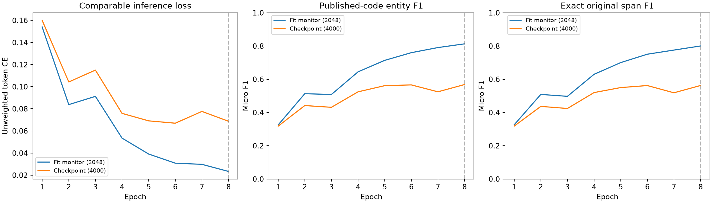

# NER preprocessing preflight and short training pilot

## Result

The recurrent NER pipeline has been implemented and exercised, including a full BIO/offset eligibility census, padding/loss checks, a tiny-set memorization check, eight real training epochs, and gold-free forward inference on every competition test text.

**The code checks pass, but this does not guarantee absence of overfitting or good test accuracy.** The pilot has a substantial train/development generalization gap, and the earlier source/test shift remains. No final audit, calibration, labeled in-domain sample, or leaderboard target score was used to choose or evaluate this pilot.

## 1. BIO labels and original character offsets

`ner_data.py` tokenizes original text into words, punctuation, underscores, combining marks and newline tokens. Token boundaries are computed **before** normalization. Only vocabulary keys are NFC-normalized and case-folded, so emoji, decomposed Unicode and case-folding length changes cannot shift the original text offsets. Every non-whitespace input character is retained. Tokenization does not inspect gold spans.

All 1,010,000 Ukrainian source rows were checked. For representable labels, BIO encoding followed by decoding must exactly reproduce the whitespace-trimmed character spans. Distinct adjacent locations receive separate `B-LOC` labels. Gold spans inside a word are not silently extended, and words are not split at label-dependent boundaries that would be unavailable at inference.

| Original partition | Rows | Whole-word BIO-incompatible rows | Whitespace-trimmed annotation spans |
|---|---:|---:|---:|
| fit | 999,948 | 1,485 | 203 |
| excluded_overlap | 52 | 0 | 0 |
| audit | 4,000 | 7 | 1 |
| checkpoint | 4,000 | 4 | 1 |
| calibration | 2,000 | 4 | 1 |

The fit portion has **1,485 incompatible rows (0.149%)**, containing 1,501 partial-token-boundary findings. This is an incompatibility with this **whole-word BIO representation**, not proof that every such annotation is semantically wrong. Some names are stems within inflected words; other examples extend partway into a following word. Arbitrary automatic repair could corrupt supervision.

Policy implemented: quarantine the entire incompatible fit row; never teach unrepresentable positive tokens as `O`. This leaves **998,463 eligible fit rows before within-fit group deduplication**. The pilot then samples 12,000 unique eligible fit groups. The source CSV and frozen validation manifest remain unchanged. Original annotations remain accessible in the audit and example records.

Whitespace trimming affects only BIO targets and is counted explicitly. Original raw spans and original strings remain the scoring gold, so strict span scores can penalize whitespace differences even when the competition normalizer ignores them. The entire checkpoint partition remains in entity evaluation, including its 4 incompatible rows; only those rows are omitted from token cross-entropy. Therefore the validation score is not inflated by dropping difficult examples.

The same eligibility checks were applied to calibration/audit annotations as a data-integrity census, with **no model predictions or model-selection scores** on those partitions. Inspecting format/support is distinct from using final audit performance to tune a model.

Files: `reports/ner_preprocessing_audit.json`, `reports/ner_preprocessing_counts.csv`, and the reusable eligibility manifest `data/ner_bio_eligibility.csv`.

## 2. Padding and loss masking

The shared BiGRU uses packed sequences with true lengths. Input padding is ID 0; padded labels are **-100**. Cross-entropy ignores those labels, and the padding embedding receives zero gradient. Regression tests verify that:

- Adding right padding does not change real-token NER logits.
- Loss with ignored padded positions equals loss computed only on real positions.
- Replacing padded logits with extreme values cannot change loss.
- The padding embedding's gradient is zero.

Every training batch is checked for finite loss and gradients. Gradient norms are clipped to 1.0; the saved history contains the pre-clipping norms. Class weights are learned from the 12,000 fit examples only, not checkpoint labels: O/B/I counts are [212951, 3962, 889], and weights are [1.0, 7.3313, 8.0]. The fixed square-root inverse-frequency rule is capped at 8. These weights encourage entity recall but can also increase false positives.

The training optimization loss is class-weighted. For the learning-curve comparison below, both fit-monitor and checkpoint losses are **unweighted** cross-entropy, computed in evaluation mode on real supervised token positions. They are comparable to each other; they should not be directly compared to the weighted training-batch loss.

## 3. Long texts and complete inference

Use windows of at most 128 tokens with overlap 32. Every original token must be covered. During training, overlapped copies of an already supervised token have label -100, so each target token contributes loss once. Inference averages overlapping token probabilities, then decodes BIO **once over the complete original document**. It does not independently decode chunks and then concatenate entity lists.

A controlled test places one entity across a window edge and verifies exact recovery of the full span. Other tests cover 0, 1, 127, 128, 129, 256 and 1,001 token inputs. Empty texts bypass the RNN rather than creating zero-length packed sequences. An orphan predicted `I-LOC` is treated as a new `B-LOC` and the repair count is recorded; this decoding policy is fixed, not tuned on validation.

Actual best-checkpoint inference was run on **all 477 unlabeled test texts**:

- 83 texts exceed 128 tokens; the maximum is 626 lexical/punctuation/newline tokens.
- 598 windows cover all 35,679 token positions.
- All token probabilities are finite and sum to one.
- All predicted spans stay within the original text, are nonempty, ordered and unique.
- No test labels were read and **no test F1 was computed**. Structural correctness of predicted spans does not imply correct locations.

Counts differ from EDA whitespace-token lengths because this tokenizer explicitly separates punctuation, emoji and newlines. No test text is reduced to only its first window in NER inference.

## 4. Tiny-set memorization health check

The model intentionally memorized 32 fit-only texts: 16 positive and 16 negative. Dropout/weight decay were disabled only for this diagnostic, with learning rate 0.01. After 20 updates, official-code F1 and trimmed-span F1 were both **1.0000**. This checks that labels, gradients, model outputs and decoding can work together; it is deliberately overfitted and says nothing about generalization.

## 5. Real training pilot and error comparison

Configuration: learned word embeddings (64), one bidirectional GRU layer (64 hidden units per direction), dropout 0.2; AdamW, learning rate 0.002, weight decay 0.01, batch 64, seed 42. Vocabulary is capped at 30,000 learned words plus PAD/UNK, fitted on pilot fit texts only. No transformers or self-attention are used.

The pilot used **12,000** eligible unique fit groups and **eight fixed epochs**, on cuda. A fixed 2,048-text subset of those fit texts monitors training quality in evaluation mode. Every epoch evaluates all 4,000 checkpoint texts. Epoch 8 had the highest published-code checkpoint F1 and was saved. This is development selection, not an unbiased final evaluation or NER cross-validation.

| Best selected epoch | Fit monitor (2,048) | Checkpoint (4,000) |
|---|---:|---:|
| Official-code entity F1 | 0.8131 | 0.5682 |
| Precision | 0.7169 | 0.4917 |
| Recall | 0.9390 | 0.6730 |
| Exact raw span F1 | 0.8003 | 0.5625 |
| Unweighted token CE | 0.0233 | 0.0687 |
| False-positive text rate on gold-empty texts | 0.0549 | 0.1241 |

The F1 gap is **0.2448**, or 24.48 percentage points. Checkpoint has TP=887, FP=917, FN=431 under official normalization; the gold support differs slightly from raw mention count because the evaluator deduplicates surfaces within a text. Precision is lower than recall, and 12.41% of gold-empty checkpoint texts receive at least one prediction. False positives are therefore a concrete issue, not just a small aggregate F1 gap.

**There are signs of limited generalization and emerging overfitting.** Fit-monitor F1 increases from 0.7136 at epoch 5 to 0.8131 at epoch 8, while checkpoint F1 only changes from 0.5614 to 0.5682. Checkpoint cross-entropy reaches its minimum earlier and later fluctuates. The gap alone cannot identify a single cause: this small training subset has limited vocabulary coverage, checkpoint OOV rate is **14.36%**, rare names generalize poorly, and entity-weighted loss encourages false positives. One seed and eight epochs do not establish a stable ranking or optimal stopping point.



No thresholds or merging variants were searched, and no calibration or final audit score was observed. Example checkpoint errors are saved in `reports/ner_pilot_error_examples.json`; the first examples are an inspection aid, not a random error-rate estimate. Full checkpoint predictions are saved for reproducibility. The best model and vocabulary are in `outputs/ner_pilot_best.pt`.

Independent rescoring of the saved prediction CSV reproduces F1=0.5682. A 2,000-replicate group bootstrap gives [0.5457, 0.5907]. This interval is conditional on these predictions and does not account for selecting the best epoch, training seeds or target-domain shift; it is not a final performance guarantee.

## 6. What to change before scaling up

1. Use the audited eligibility manifest, preserve original offsets, and retain all checkpoint texts for entity scoring. Do not silently reuse the old O/LOC Parquet as BIO.
2. Scale training data gradually before increasing model size or epochs. This pilot sees about 1.2% of fit rows; more vocabulary/name coverage may help, but improvement is not guaranteed.
3. Use early stopping and checkpoint selection on the fixed checkpoint set. Do not infer from steadily falling training loss that more epochs improve validation.
4. After choosing a checkpoint, tune a **small prespecified** decoding/threshold grid only on calibration. Class-weight strength is a training hyperparameter, selected through development experiments, not by looking at final audit results.
5. Keep dropout/weight decay, compare a few fixed seeds, and measure precision/recall as well as F1. A larger network is not the next automatic step.
6. Keep final audit sealed for model performance, and do not present the source pilot score as expected Public LB performance. Target-domain shift remains substantial.

The shared adversarial tokenization was updated to the same offset-preserving vocabulary-key policy (including underscores/combining marks), and the recurrent adversarial experiment was rerun. Current OOF domain ROC-AUC is **0.9493**. Its three-fold predictions, result JSON and validation report are updated; it remains a domain-separability metric, not NER F1. The main encoder configuration remains identical to the adversarial encoder.

## Reproduction

```powershell
.venv/Scripts/python.exe -m unittest discover -s assignment3 -p "test_*.py"
.venv/Scripts/python.exe assignment3/audit_ner_preprocessing.py
.venv/Scripts/python.exe assignment3/pilot_ner.py
.venv/Scripts/python.exe assignment3/check_ner_inference.py
.venv/Scripts/python.exe assignment3/build_ner_preflight_report.py
```

Source/partition hashes, eligibility hashes, selected row IDs, model checkpoint, optimization history and predictions are retained. For full adversarial reproduction use `validation.py`, which now imports the same tokenizer. GPU stochastic operations can still differ slightly between environments despite fixed seeds.

AI assistance: Codex implemented and executed these checks and drafted this report from measured outputs. Keep the actual chat link/transcript for the assignment's AI disclosure.
