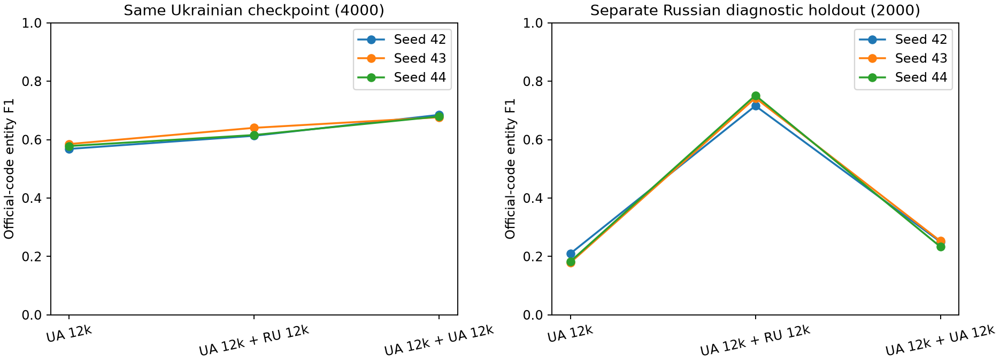

# Russian auxiliary corpus: full audit and augmentation experiment

## Decision

Adding Russian data improves this pilot over the smaller Ukrainian baseline on average, but extra Ukrainian data is the stronger matched-update control. This does not establish a specific advantage for Russian augmentation.

This covers the **entire downloaded Russian CSV**, not an extrapolation from a sample. Structural quality, duplicates, cross-corpus overlap and document-safe partitions were checked globally. Semantic review covers 100 sampled contexts. The training experiment is deliberately a small controlled pilot, not full training on eight million sentences or a Kaggle submission.

## 1. Provenance and task compatibility

The competition README identifies `ru_geo_dataset.csv` as derived from [Nerus](https://github.com/natasha/nerus). Its authors describe a silver-standard news corpus with automatically generated entity annotations, rather than independent human gold. Therefore valid offsets do not establish semantic truth. The competition CSV conversion is assessed here directly; upstream quality claims are not treated as measurements of this file.

The supplied file is 2,022,090,611 bytes, with **8,028,840 rows and 739,190 documents**. Fields are text, LOC/ORG/PER character markers, `doc_id` and `sent_id`. We train only the LOC target using the existing recurrent backbone. Source labels being machine-generated does not introduce a transformer into our training architecture.

Russian CSV SHA-256: `17876a3e5c6f63c7c837e4da5a9c99fd02f50442161a870a64111ea8b7acd71b`. Ukrainian CSV SHA-256: `551afb6a09bef80adad496a11876f1ff14fb9e34e33fee869efb0da85d060874`. The original Ukrainian manifest is unchanged.

## 2. Full-corpus distribution

| Corpus | Sentences | LOC mentions | No-LOC sentences | Median characters | Median tokens | P95 tokens |
|---|---:|---:|---:|---:|---:|---:|
| Ukrainian | 1,010,000 | 345,114 | 76.89% | 91 | 16 | 34 |
| Russian | 8,028,840 | 3,708,173 | 69.31% | 110 | 18 | 38 |

Tokens use the same original-offset word/punctuation/newline expression as the NER pilot. They differ from EDA whitespace counts. Empty Russian text rows: 0. Russian source sentences with newlines: 0. Script-presence indicators are descriptive, not ground-truth language labels; Russian-specific letters appear in 81.59% of RU sentences, Latin letters in 17.00%.

Russian LOC surface vocabulary (NFC/case-fold/whitespace only) has 130,797 distinct strings, versus 44,824 Ukrainian. Shared strings: **3,336**, or 7.44% of the Ukrainian vocabulary. This is literal surface overlap, not geographic identity overlap; translations and inflected forms remain distinct. Country/city coverage alone does not align independently learned embeddings across languages.

The Russian corpus contains relatively more LOC-positive sentences. Mixing it changes language, genre, vocabulary competition and positive-label density together. No experiment below isolates pure language causality.

## 3. LOC annotation quality and agreement

| Full Russian audit check | Findings |
|---|---:|
| LOC_parse_failure | 0 |
| LOC_noninteger_or_shape | 0 |
| LOC_out_of_bounds | 0 |
| LOC_overlap | 0 |
| LOC_duplicate_spans | 0 |
| LOC_edge_whitespace | 13 |
| LOC_partial_token | 7,712 |
| LOC_ORG_overlaps | 9 |
| LOC_PER_overlaps | 10 |
| missing_doc_id | 0 |
| missing_sent_id | 0 |

**6,769 rows (0.0843%) are incompatible with this whole-word BIO representation.** Partial-word markers are not automatically expanded. Annotation edge whitespace is trimmed only for BIO targets and counted; original gold strings stay unchanged for scoring. Auxiliary type overlap flags may indicate nesting, conversion or annotation ambiguity; they are not automatically relabeled.

Within identical canonical texts, **4,902 groups disagree on conservative-normalized LOC surface sets**. This is an observable consistency problem, not proof of which annotation is right. The check does not identify every wrong occurrence when the same surface is repeated, and does not replace semantic adjudication. Such conflicting groups are excluded from the auxiliary fitting pool rather than resolved arbitrarily.

### Context review

We reviewed 100 full-file reservoir-sampled contexts: 80 positive and 20 negative, seed 42. The sampling is stratified for diagnosis, so its 80/20 ratio is not a prevalence estimate. This is AI-assisted contextual review, not independent expert annotation and not a semantic accuracy benchmark.

The reviewed geographic labels are mostly plausible in context, but important transfer issues remain:

- Case 5 labels the European Commission as LOC, a candidate ORG/LOC type error.
- Cases 33, 46 and 57 extract a geographic component separately from an institution head. The Ukrainian examples do not always follow the same policy.
- Case 38 preserves a hyphenated New York as one LOC; Ukrainian examples show mixed whole/split treatment of hyphenated places.
- Case 69 includes a street name but not the house number; Ukrainian address scopes sometimes include numbers and punctuation.
- Several contexts contain fused sentence/source fragments. There are also imperfect auxiliary PER/ORG boundaries.

See `RU_ANNOTATION_REVIEW_100.md` and the CSV/JSON for each context and note. Labels were not manually rewritten. Agree on a shared LOC contract before using either corpus as unquestioned gold.

## 4. Duplicates and Ukrainian overlap

| Corpus | Exact duplicate groups | Exact excess rows | Canonical groups | Canonical excess rows |
|---|---:|---:|---:|---:|
| uk | 2,445 | 2,454 | 2,512 | 2,523 |
| ru | 249,385 | 523,501 | 250,054 | 525,636 |

Canonical means NFC + case folding + whitespace collapse. Excess rows are copies beyond one per group, not the number of rows belonging to duplicate groups. Full-file joins find **no exact or canonical full-text overlap between the supplied Russian and Ukrainian corpora**. The separate protected key set also includes the unlabeled test texts and provided 26-example texts; active RU pools have 0 protected matches.

This does **not** prove absence of translated, paraphrased, fuzzy or shared-source news. No translation-equivalence or semantic near-duplicate search was performed. Shared names are expected and are not sentence leakage by themselves.

## 5. Document-safe Russian validation

Base assignment is deterministic: `BLAKE2b("42:ru:" + doc_id) mod 10 == 0` selects Russian validation, otherwise Russian fit. All sentences of a document have the same base assignment. `doc_id` is namespaced to the Russian corpus; equal numbers in other sources are not the same document.

Document grouping alone is insufficient because duplicate sentences occur in different documents. We reserve canonical keys from retained Russian validation. If a Russian fit document contains any reserved validation sentence, **the entire fit document is quarantined**. Any document matching protected Ukrainian/external texts is similarly quarantined. Thus simply changing sentence folds cannot reintroduce document context leakage.

Further fit-only filtering excludes incompatible BIO rows, conflicting canonical LOC groups, redundant Ukrainian-fit sentences and within-fit canonical copies. Russian validation is not cleaned to make its entity score easier. No Ukrainian calibration/final audit score is used.

| Russian partition / exclusion | Rows | Documents represented | LOC mentions |
|---|---:|---:|---:|
| excluded_RU_duplicate | 170,104 | 80,596 | 76,097 |
| excluded_RU_valid_overlap_doc | 1,602,493 | 132,569 | 759,620 |
| excluded_alignment | 5,148 | 2,449 | 7,479 |
| excluded_label_conflict | 6,346 | 4,959 | 8,756 |
| ru_fit | 5,440,386 | 532,263 | 2,484,003 |
| ru_valid | 804,363 | 73,953 | 372,218 |

Document counts in exclusion rows can overlap across row-level reasons and must not be summed as disjoint documents. The aggressive cross-document quarantine removes many sentences; this is a real cost of strict leakage control and can alter the retained distribution. More than five million usable fit sentences remain.

Checks on active partitions: **0 shared document IDs, 0 shared canonical sentences between RU fit and RU valid, and 0 protected Ukrainian/external matches**. Duplicate `(doc_id, sent_id)` groups in the source: 0. Missing IDs are reported in the quality table.

The full row manifest is `data/russian_audit/ru_split_manifest.parquet`; SHA-256 `23c17736c799113691b3eddd6bce6eb34c4d971ae1623cc8df87bd60ac535e1b`. Large metadata, the on-disk DuckDB and spill files remain under ignored `data/`. Counts, hashes and small tables are under `reports/` for review.

## 6. Controlled experiment: does Russian data help?

The protocol was recorded in `ru_experiment_plan.json` before training results:

1. **UA_12k:** the same original 12,000 Ukrainian pilot groups.
2. **UA_12k_plus_RU_12k:** the same base plus 12,000 eligible, deduplicated, document-safe Russian sentences.
3. **UA_12k_plus_UA_12k:** the same base plus 12,000 additional eligible unique Ukrainian fit groups.

The two 24k arms match sentence counts and optimizer-update counts. Added sentences are at most 128 tokens so one row gives one training window. Actual sequence lengths and FLOPs can differ. The 12k baseline receives fewer updates, so an improvement over it alone would not establish that Russian text is better than more Ukrainian text.

All arms use the original embedding64/BiGRU64x2/BIO configuration, dropout .2, AdamW lr=.002, weight decay .01, batch64 and eight epochs. Seeds are 42,43,44. Vocabulary is fit on each arm's training texts only, capped at 30k words plus PAD/UNK. Loss weights are fixed from the base Ukrainian 12k in every arm: [1.0, 7.331327438354492, 8.0]. This avoids changing both data and loss weighting at once, although resulting label density still differs.

Best epoch is selected on the **same 4,000 Ukrainian checkpoint texts**. The Russian diagnostic contains a fixed 2,000 sentences from held-out RU documents and is evaluated only after selecting a checkpoint. Models, vocabularies and predictions are saved separately from the original pilot.

### Every run

| Seed | Arm | Best epoch | UA checkpoint F1 | UA precision | UA recall | RU diagnostic F1 | UA token OOV |
|---|---|---:|---:|---:|---:|---:|---:|
| 42 | UA_12k | 8 | 0.5682 | 0.4917 | 0.6730 | 0.2099 | 14.36% |
| 42 | UA_12k_plus_RU_12k | 6 | 0.6132 | 0.5760 | 0.6555 | 0.7158 | 16.74% |
| 42 | UA_12k_plus_UA_12k | 8 | 0.6849 | 0.6667 | 0.7041 | 0.2500 | 12.37% |
| 43 | UA_12k | 7 | 0.5849 | 0.5368 | 0.6426 | 0.1788 | 14.36% |
| 43 | UA_12k_plus_RU_12k | 8 | 0.6405 | 0.6007 | 0.6859 | 0.7427 | 16.74% |
| 43 | UA_12k_plus_UA_12k | 7 | 0.6767 | 0.6526 | 0.7026 | 0.2528 | 12.37% |
| 44 | UA_12k | 8 | 0.5781 | 0.5180 | 0.6540 | 0.1828 | 14.36% |
| 44 | UA_12k_plus_RU_12k | 7 | 0.6158 | 0.5984 | 0.6343 | 0.7516 | 16.74% |
| 44 | UA_12k_plus_UA_12k | 8 | 0.6794 | 0.6360 | 0.7291 | 0.2332 | 12.37% |

### Means across three seeds

| Arm | Mean UA F1 | Seed SD | Mean RU F1 | Mean UA OOV |
|---|---:|---:|---:|---:|
| UA_12k | 0.5771 | 0.0084 | 0.1905 | 14.36% |
| UA_12k_plus_RU_12k | 0.6232 | 0.0150 | 0.7367 | 16.74% |
| UA_12k_plus_UA_12k | 0.6803 | 0.0042 | 0.2453 | 12.37% |

### Paired comparisons on the Ukrainian checkpoint

| Contrast | Mean F1 delta | Conditional 95% document interval | Per-seed deltas |
|---|---:|---|---|
| UA_12k_plus_RU_12k − UA_12k | +0.0461 | [+0.0332, +0.0593] | +0.0450, +0.0555, +0.0377 |
| UA_12k_plus_UA_12k − UA_12k | +0.1032 | [+0.0888, +0.1178] | +0.1166, +0.0917, +0.1013 |
| UA_12k_plus_RU_12k − UA_12k_plus_UA_12k | -0.0571 | [-0.0706, -0.0425] | -0.0717, -0.0362, -0.0636 |

Intervals resample the same 4,000 checkpoint groups jointly across models and fixed seeds, 2,000 times. They condition on the fitted/selected models and do not include unseen-seed, checkpoint-selection or domain-shift uncertainty. Three seeds are informative but not a broad robustness study. These are **development holdout scores, not NER CV, final audit or Public LB results**.



## 7. Interpretation and handoff

Adding Russian data improves this pilot over the smaller Ukrainian baseline on average, but extra Ukrainian data is the stronger matched-update control. This does not establish a specific advantage for Russian augmentation.

Use the paired contrasts rather than cherry-picking a best seed or the Russian diagnostic alone. Higher RU diagnostic F1 means better source-domain Russian NER, not automatically better performance on mixed Ukrainian competition posts.

The result applies to **a 1:1 data mixture with random word embeddings and a capped shared vocabulary**. Adding Russian can crowd Ukrainian tokens out of the vocabulary; compare the measured UA OOV rates. It can also change type conventions and entity density. These are plausible mechanisms, not causally isolated explanations.

Do not generalize this pilot into “all Russian data is useful/useless.” A lower mixing ratio, multilingual/subword embeddings, a character BiGRU, or Russian pretraining followed by Ukrainian fine-tuning remain separate experiments. Do not launch all eight million rows blindly or tune the final audit based on these results.

For training with this source, use the saved RU split manifest, preserve document namespaces and original offsets, keep the Ukrainian split fixed, and retain corpus provenance in experiment logs. Never reuse sentences from the RU diagnostic or Ukrainian checkpoint as fit examples. Any cleaned annotation version needs an explicit version and fresh, honest comparisons.

## Reproduction and delivery

```powershell
python russian_corpus_audit.py
python russian_augmentation_experiment.py
python build_russian_report.py
python -m unittest discover -s . -p "test_*.py"
```

Download the supplied `ru_geo_dataset.csv` separately with Kaggle. The scan is chunked; DuckDB uses a 256 MB limit and disk spill. `--stage split` can rebuild splits from complete metadata; `--stage samples` freezes the experiment selection without rescanning both CSV files. The large data, metadata and weights are excluded from Git; push code, reports, figures, sources and notebooks.

Full-corpus JSONs, partition table, experiment plan, nine run records, histories, predictions and paired comparisons are retained. The original Ukrainian manifest and pilot artifacts are not overwritten. No external messages or Kaggle submissions were sent.

AI assistance: Codex implemented/executed the audit and experiment and reviewed the 100 contexts. Keep the actual chat transcript/link for the assignment disclosure; semantic notes are not independent human gold.
